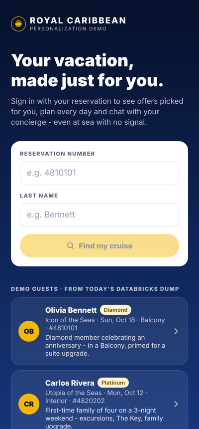
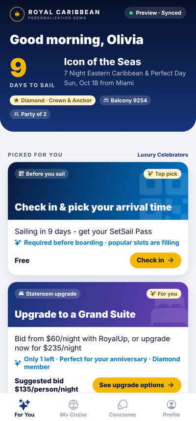
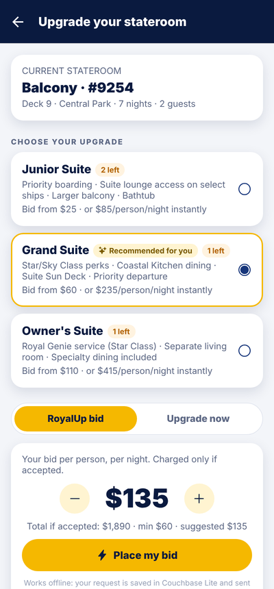
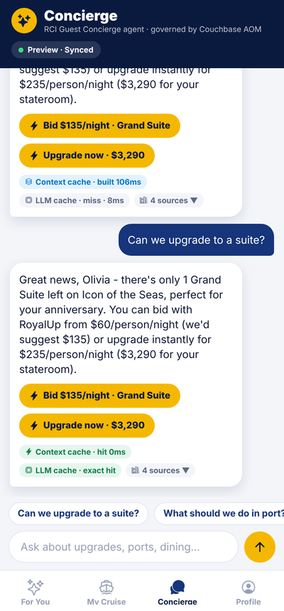
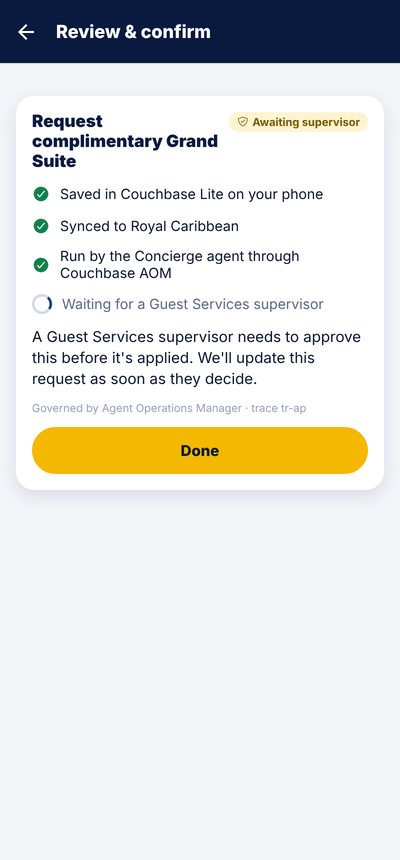
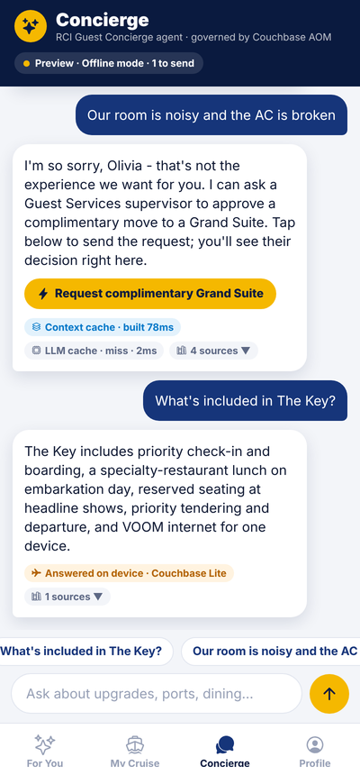
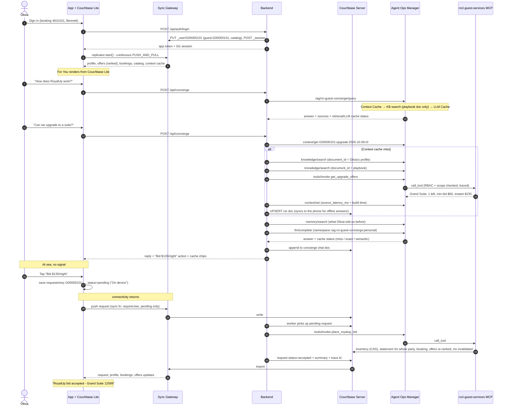
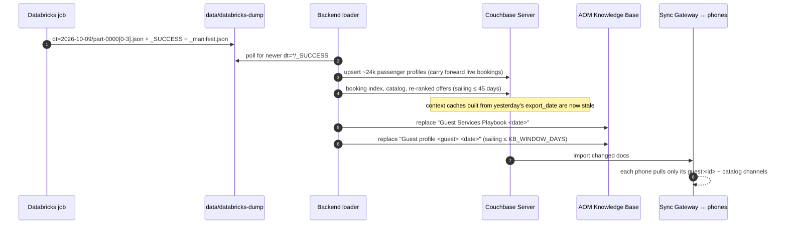
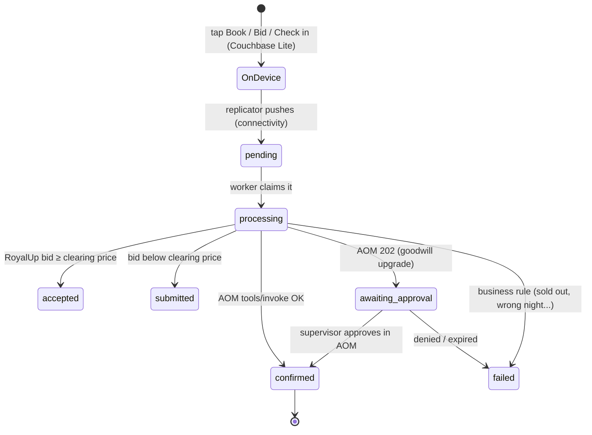

# Royal Caribbean · Mobile RAG Personalization Demo

A guest-facing cruise app that personalizes itself from a **daily Databricks dump** of passenger reservation data. It keeps working **at sea with no signal** because the data lives on the phone in **Couchbase Lite**. Its concierge agent is **registered with, and governed by, the Couchbase Agent Operations Manager (AOM)**:

* answers are grounded in AOM's **Knowledge Base**
* it is registered as an AOM **RAG Application** (`rci-guest-concierge`), so its queries, cache hits and cost savings show on AOM's *RAG Applications* page
* the context it builds for each answer is cached in AOM's **Context Cache** and in Couchbase, which syncs it to the phone
* LLM calls go through AOM's **LLM Caching** gateway
* every booking (room upgrades, shore excursions, dining, packages, spa, check-in) runs as an RBAC-checked, traced and audited AOM tool call, with human approval for complimentary upgrades

The app's structure is based on [Fujio-Turner/mobile_field_service](https://github.com/Fujio-Turner/mobile_field_service): Expo / React Native, Couchbase Lite via `cbl-reactnative`, Sync Gateway session auth, and offline-first writes that sync when the radio comes back.

| Sign in | For You | Upgrade | Concierge (AOM) | Approval tier | Offline |
|---|---|---|---|---|---|
|  |  |  |  |  |  |

---

## What the demo shows

| Concept | Where you see it |
|---|---|
| **Personalization from Databricks** | *For You* ranks upgrades, packages, excursions, dining and spa offers per guest. The ranking uses the model scores and preferences from that morning's dump, plus live inventory. The feed re-ranks after every booking. |
| **Couchbase Lite: offline and online** | Every screen renders from the on-device database. Turning on *Profile → At sea - no signal* pauses replication. You can still browse, place a RoyalUp bid or book an excursion: it's saved as a `requests` document marked **On device**, and when you turn the switch off it syncs and is confirmed. |
| **Registered with AOM** | `scripts/register_with_aom.py` sets up four things in AOM: the **RCI Guest Concierge** agent identity (role `support_agent`, scoped to 11 tools), the **`rccl-guest-services`** MCP server, the approval tier for goodwill upgrades, and the **`rci-guest-concierge` RAG Application**. |
| **AOM RAG Application** | Playbook questions ("How does RoyalUp work?") go to `POST /v1/agent/rag/rci-guest-concierge/query`. AOM retrieves behind its Context Cache, generates behind its LLM Cache, and counts the query on the *RAG Applications* page. The app is scoped to the one *Guest Services Playbook* document, so a generic question can never retrieve another guest's profile. The loader re-scopes it to each day's new playbook. |
| **Knowledge Base fed by the daily dump** | The loader publishes the *Guest Services Playbook* plus one *Guest profile* document for each passenger sailing soon. The concierge always searches with a `document_id` filter, so a guest's answer can only be grounded in **their own** profile. |
| **Context Caching** | For personal questions the concierge assembles context (the guest's own KB profile chunks, playbook chunks and live tool facts) and caches it in **AOM's Context Cache** (`/v1/context/set`, namespace `rag:rci-guest-concierge:guest-context`, key `<guest>:<intent>:<export_date>:r<profile rev>`, with the real build time as `source_latency_ms`). The next question is a `/v1/context/get` hit, shown as a `Context cache · hit` chip and as latency avoided on AOM's *Context Cache* page. The next dump or any booking by that guest changes the key, so the entry is never served stale. The same context is written to Couchbase as `ctx::<guest>::<intent>`, which syncs to the phone; that copy is what the offline concierge answers from. |
| **LLM Caching** | Every completion goes through AOM's LLM cache. Playbook questions contain no personal data, so the second guest to ask the same question gets `LLM cache · exact hit` from the RAG application. Personal questions go through `/v1/llm/complete` in the `rag:rci-guest-concierge:personal` namespace, which AOM also attributes to the RAG application. |
| **Governed actions** | Upgrades (RoyalUp bid, instant, goodwill), excursions, specialty dining, packages, spa and online check-in all run as `POST /v1/tools/invoke`. AOM re-checks RBAC and the agent's tool scope, traces and audits the call, scans the response, and holds goodwill upgrades for a person to approve. |

---

## Architecture


| # | Flow |
|---|---|
| **1** | Every morning the Databricks job drops a `dt=YYYY-MM-DD` JSON Lines partition, and the loader picks up the newest one with a `_SUCCESS` marker. |
| **2** | The loader upserts every passenger profile, re-ranks offers and publishes the catalog in Couchbase Server. The concierge reads and writes its **context cache** there, the worker reads pending requests, and the MCP tools apply bookings. |
| **3** | The loader replaces the AOM **Knowledge Base** documents (the Guest Services Playbook and one profile per passenger sailing soon), then re-scopes the **RAG Application** to the new playbook. |
| **4** | Sign-in: the backend creates the guest's Sync Gateway user (channels `guest:<id>`, `catalog`) and mints a session. The concierge is called over `/api`. |
| **5** | **Couchbase Lite** replicates continuously with Sync Gateway. Every screen renders from the phone, and taps become `requests` documents saved locally, even offline. |
| **6** | Playbook questions go to the concierge's **RAG Application** in one call. Personal questions check AOM's **Context Cache**; on a miss the concierge does document-scoped **KB retrieval**, stores the context in AOM and Couchbase, recalls **memory**, then calls the **LLM Caching** gateway. |
| **7** | AOM calls the LLM provider only on a cache miss. |
| **8** | Sync Gateway carries requests up and results back down: the phone pushes its pending request, and the confirmed stateroom, booking and re-ranked offers come back. |
| **9** | The worker runs each request as the **RCI Guest Concierge** agent through `POST /v1/tools/invoke`, so RBAC, tool scope, the approval tier, a trace and an audit entry are applied. |
| **10** | AOM calls the `rccl-guest-services` MCP server, which applies the upgrade or booking in Couchbase, and that syncs back to the phone (2 → 8 → 5). |

### A guest's workflow, end to end

Olivia (Diamond, anniversary, Balcony on *Icon of the Seas* in 9 days) signs in, asks the concierge about a suite, bids with RoyalUp while she's offline, and the result syncs back when she reconnects:



A goodwill upgrade follows the same path. The difference is that AOM answers `202 pending_approval`: the request shows **Awaiting supervisor** on the phone until someone approves it on AOM's Approvals page. The worker then re-invokes with the `approval_id`.

### The daily data flow



### Offline-first request lifecycle



---

## Quick start

### 1. Browser preview in about 2 minutes (no Docker, no AOM)

The backend can run on an in-memory store, and the app has a browser preview engine that syncs the same documents over REST. Use this to look at the UX. Couchbase Lite needs a device build (step 3).

```bash
python3 databricks/generate_mock_dump.py            # ~100 MB dump → data/databricks-dump/dt=<today>/
cd backend && python3 -m venv .venv && . .venv/bin/activate && pip install -r requirements.txt
uvicorn app.main:app --port 8200                    # STORE_DRIVER=memory by default
# new terminal
cd mobile && npm install && npx expo start --web    # sign in with a demo guest
```

### 2. Full stack: Couchbase, Sync Gateway and AOM

You need Docker Desktop, and the [Couchbase Agent Operations Manager](https://github.com/erikhinderer/couchbase-agent-operations-manager) running on the same machine at `https://localhost:8090`, with its admin password set.

```bash
cp .env.example .env
./scripts/setup-corporate-ca.sh            # only behind a TLS-inspecting proxy (Zscaler etc.)
docker compose up -d --build               # couchbase, init, sync-gateway, sg-init, backend, web
docker compose logs -f backend             # wait for "Loaded dump 2026-10-09: … rows"

python3 scripts/register_with_aom.py --admin-password '<AOM admin password>'
docker compose up -d --build backend       # picks up AOM_* from .env, publishes the KB, scopes the RAG app
```

`register_with_aom.py` is idempotent. Run it again with `--rotate` to issue a new agent key. After it runs, AOM shows:

* **Agents**: *RCI Guest Concierge*, role `support_agent`, scoped to the 11 `rccl-guest-services::*` tools
* **Servers / Catalog**: `rccl-guest-services` (trusted) and its tools
* **Knowledge**: *Guest Services Playbook <date>* and *Guest profile G… <date>* documents
* **Approvals config**: `rccl-guest-services::apply_goodwill_upgrade` requires a human
* **RAG Applications**: *RCI Guest Concierge (mobile)* (`rci-guest-concierge`), roles `support_agent` and `admin`, scoped to today's playbook document. Its activity counts playbook queries plus the concierge's personal LLM calls and context-cache lookups, all in `rag:rci-guest-concierge:*` namespaces
* **Context Cache**: entries in `rag:rci-guest-concierge:guest-context` (one per guest and intent) and `rag:rci-guest-concierge` (the RAG app's retrievals)

If the RAG application is created before the backend has published a playbook, it is registered **disabled**. The backend enables it and sets its document scope on its next load. `GET http://localhost:8200/api/status` shows its state under `aom.rag_app`.

Configure an LLM provider key in AOM to get generated answers. Without one, AOM returns a labelled stub: the backend then writes the answer itself from the same retrieved context, and AOM still reports the LLM-cache status (hit or miss).

Then open **http://localhost:8081** for the app in a browser, or **http://localhost:8200** for a page linking every service.

| Port | Service |
|---|---|
| `8081` | **The app in a browser** (`web` service), shown inside a phone frame (add `?frame=0` for full width): same screens and documents, synced over REST instead of Couchbase Lite |
| `8200` | Backend API + MCP server (`/rccl/mcp`); `/` lists every link |
| `4984` | Sync Gateway public, which is what phones replicate with: `ws://<host>:4984/royal` |
| `127.0.0.1:4985` | Sync Gateway admin |
| `127.0.0.1:18091` | Couchbase Web Console (Administrator / password123) |

Ports are chosen so this stack runs alongside AOM (8090, 8091-8096) and the NOV demo.

### 3. The app on a device with Couchbase Lite

Couchbase Lite is a native module, so it needs a **development build**; Expo Go can't load it, the same as mobile_field_service. `npm install` runs `scripts/fetch-cbl-native.sh`, which fetches the `cbl-reactnative` native submodules that npm skips.

```bash
cd mobile
cp .env.example .env                       # API + Sync Gateway URLs (LAN IP for a physical phone)
npm install
npx expo run:ios -d "iPhone 16 Pro"        # or: npx expo run:android
npm run start:ios                          # later runs: Metro on localhost
```

The `web` service serves a prebuilt browser bundle (`web/dist.tgz`). After changing the app, rebuild it with `cd mobile && npm run export:web:docker`, then `docker compose up -d --build web`.

With `EXPO_PUBLIC_DB_ENGINE=auto`, the app uses Couchbase Lite whenever the native module is linked. *Profile → Offline & sync* shows the database path, the Sync Gateway endpoint, the replicator status and how many documents are waiting to send. The same notes as mobile_field_service apply: Xcode 26.4+ needs `plugin.fmt.js` (included), and there is a simulator keyboard toggle (⌘K).

### 4. Kubernetes with Helm (K3s / Rancher)

`deploy/k8s/deploy.sh` deploys AOM (**agent-ops**) and this demo (**royal-app**) onto a single-node K3s cluster, such as one managed by Rancher, without a container registry. Run it from your Mac, in this repository:

```bash
AOM_ADMIN_PASSWORD='<12+ characters>' ./deploy/k8s/deploy.sh      # MOTHER=ehind@192.168.111.4 by default
```

It runs four steps:

1. **Build.** It builds the three AOM images from `AOM_DIR` (default `~/github-couchbaselabs/couchbase-agent-operations-manager`) and this demo's `rccl-backend` and `rccl-web` images, for the node's CPU architecture.
2. **Import.** It copies the images over SSH and imports them into K3s's containerd. This asks for your sudo password on the node once.
3. **Install.** It runs `helm upgrade --install` on the node for both charts, and installs helm into `~/.local/bin` there if it's missing:
   * `aom` in namespace `agent-ops`, from AOM's own chart with `values-k3s.yaml`
   * `royal-app` in namespace `royal-app`, from [`helm/royal-app`](helm/royal-app) with [`deploy/k8s/values-mother.yaml`](deploy/k8s/values-mother.yaml)
4. **Secrets.** The AOM admin password and any `ANTHROPIC_API_KEY` / `OPENAI_API_KEY` / `GEMINI_API_KEY` go into mode-600 values files on the node, never onto a command line.

| Resource in `royal-app` | What it does |
|---|---|
| `couchbase` StatefulSet + `couchbase-init` hook Job | Couchbase Server EE 8.0.2. The Job runs the same `init.sh` as Compose |
| `sync-gateway` + `sg-init` hook Job | Sync Gateway 4.0.4. `sync-gateway-public` exposes 4984 for Couchbase Lite |
| `backend` | Loads the dump into Couchbase and serves the MCP server. Self-registers with AOM (`AOM_AUTO_REGISTER`, see below) |
| `databricks-dump` PVC | Holds the dump. The backend's init container exports today's 100 MiB partition on first start |
| `databricks-daily-export` CronJob | 05:00 America/New_York: exports a new partition and keeps the newest 2. The backend picks it up within 5 minutes |
| `web` | The phone-framed app on 8081. nginx proxies `/api` to the backend, so the browser needs only one URL |

**Self-registration.** No register script is needed in the cluster. With `AOM_AUTO_REGISTER=true`, the backend does the following on startup and retries until AOM is up:

* signs in to AOM. On a fresh AOM, it sets `AOM_ADMIN_PASSWORD` as the admin's first-login password
* registers `rccl-guest-services` at `http://backend.royal-app.svc.cluster.local:8200/rccl/mcp`
* issues the *RCI Guest Concierge* agent and keeps its key in Couchbase
* turns on the approval tier
* publishes the Knowledge Base and the RAG application

Progress is in `/api/status` under `aom.registration`.

| URL on the node (192.168.111.4) | |
|---|---|
| `https://…:3111` | AOM dashboard (`admin` / `AOM_ADMIN_PASSWORD`) |
| `http://…:8081` | The app |
| `http://…:8200/api/status` | Backend status |
| `ws://…:4984/royal` | Sync Gateway for Couchbase Lite (point a device build's `EXPO_PUBLIC_SG_URL` here, and `EXPO_PUBLIC_API_URL` at `:8200`) |

Ports are published by K3s's built-in ServiceLB. If a Service stays `<pending>`, either ServiceLB is disabled or the port is already taken on the node. In that case, set that Service's `type: NodePort` in `values-mother.yaml`. Redeploy just one side with `ONLY=aom` or `ONLY=royal`.

---

## Demo script (about 10 minutes)

1. **Olivia Bennett** (Diamond, anniversary, *Icon of the Seas*, Balcony, 9 days out)
   * *For You*: check-in first, then **Upgrade to a Grand Suite** ("Only 1 left · Perfect for your anniversary"), then Empire Supper Club and a Couples Massage. Point out the footnote: the ranking comes from the Databricks model and the data lives in Couchbase Lite.
   * *Concierge*: "Can we upgrade to a suite?" shows `Context cache · built` and `LLM cache · miss`. Ask it again: `Context cache · hit` and `LLM cache · exact hit`. Open **sources**: Olivia's KB profile and the playbook.
   * *Profile → At sea - no signal* **on**. Place a RoyalUp bid (**On device**), then ask "What's included in The Key?" (**Answered on device · Couchbase Lite**). Switch it **off**: the bid syncs and comes back **Accepted - Grand Suite**. In AOM, show the trace and audit entry for `rccl-guest-services::place_royalup_bid`.
   * "Our room is noisy and the AC is broken" offers **Request complimentary upgrade**, which shows **Awaiting supervisor**. Approve it in AOM → *Approvals*, and the phone flips to **Confirmed**.
2. **Priya Natarajan** (Emerald, solo wellness, sails in 2 days): asks "How does RoyalUp work?" and gets an **LLM cache exact hit** from Olivia's earlier question, because the playbook namespace is shared and has no personal data. Her feed leads with the spa and Chef's Table.
3. **Carlos Rivera** (family of four, *Utopia* weekend, Interior): the feed leads with family excursions and The Key. Booking Thrill Waterpark is priced for 4, and the Empire Supper Club is correctly refused because it isn't on Utopia.

---

## The Databricks dump

`databricks/generate_mock_dump.py` writes the exact layout the Databricks notebook produces: Spark JSON Lines part files, `_SUCCESS`, and a `_manifest.json`.

```bash
python3 databricks/generate_mock_dump.py --export-date 2026-10-09 --target-mb 100 --parts 4
```

* **About 24,000 passenger reservations** (about 8,300 bookings) over 8 ships and 150 days of sailings, 100 MiB, deterministic for a given `--seed` on a given Python version. Each part is about 25 MB, under GitHub's 50 MB warning.
* One line is **one passenger on one upcoming reservation**: identity and loyalty (Crown & Anchor tier and points), the reservation (ship, itinerary with port days, stateroom, party, check-in status), preferences, up to 12 past sailings, onboard spend mix, what's already purchased for this sailing, and **`ml_scores`** from `rccl-personalization-v4.2`.
* `ml_scores` holds the propensities (upgrade, beverage, dining, excursion, spa, internet, The Key), price sensitivity, segment, next best action, recommended upgrade category and suggested RoyalUp bid.
* Three hand-built **demo personas**, with sailings relative to the export date, are always the first rows.
* `databricks/notebooks/guest_personalization_daily_export.py` is the production equivalent: Guest 360 joins, MLflow model scoring, a Delta table, and the JSON export to a Unity Catalog volume. `databricks/jobs/…job.json` schedules it daily at 05:00 America/New_York.

The loader only needs a folder with a newer `dt=*/_SUCCESS` to appear. You can sync the Volume down with `databricks fs cp -r`, or mount the cloud storage behind it into the backend container at `/data/databricks-dump`.

---

## Data model

Bucket `royal`, scope `rccl`. Sync Gateway replicates the first seven collections to Couchbase Lite (same scope and collection names on the phone). A guest's SG user only gets the `guest:<id>` and `catalog` channels.

| Collection | Document | Written by | Notes |
|---|---|---|---|
| `profiles` | `profile::<guest>` | loader, actions | The dump row + `rev` (bumped on every booking) |
| `offers` | `offers::<guest>` | personalization | Ranked *For You*, including upgrade options for offline use |
| `bookings` | `bookings::<guest>` | actions | Confirmed items shown day by day |
| `requests` | `req::<guest>::<uuid>` | **the phone** (create), worker (status) | Offline-first queue. The sync function allows `requireUser(guest_id)`, `status: pending` and creation only |
| `concierge` | `chat::<guest>` | concierge | History + answers reusable offline |
| `context_cache` | `ctx::<guest>::<intent>` | concierge | Phone copy of the **Context Cache** entry also held in AOM: KB chunks + tool facts, `export_date`, `profile_rev`, TTL 6h |
| `catalog` | `catalog::v1` | loader | Ships, ports, excursions, dining, packages, spa, FAQ |
| `inventory` | `inv::<sailing>` | actions | Unsold staterooms per category (CAS updates). Server only |
| `lookups` | `booking::…`, `kbdoc::…`, `load_state` | loader | Login index, KB document ids, load status. Server only |

The tools on the `rccl-guest-services` MCP server are `get_guest_context`, `get_upgrade_offers`, `place_royalup_bid`, `purchase_cabin_upgrade`, `apply_goodwill_upgrade` (approval required), `search_shore_excursions`, `book_shore_excursion`, `reserve_specialty_dining`, `purchase_package`, `book_spa_treatment` and `complete_online_checkin`.

---

## Configuration

Backend variables go in `.env` (see `.env.example`); `docker-compose.yml` sets the infrastructure ones.

| Variable | Default | |
|---|---|---|
| `STORE_DRIVER` | `memory` (compose: `couchbase`) | `memory` keeps guests sailing within `MEMORY_WINDOW_DAYS` |
| `AOM_URL`, `AOM_AGENT_API_KEY` | — | Agent identity, written by `register_with_aom.py` |
| `AOM_ADMIN_USERNAME`, `AOM_ADMIN_PASSWORD` | — | Used only to publish KB documents |
| `AOM_LLM_PROVIDER`, `AOM_LLM_MODEL` | AOM default | Pin the model completions use |
| `KB_WINDOW_DAYS`, `KB_PROFILE_LIMIT` | `10`, `150` | Which passengers get a KB profile each day |
| `CONTEXT_CACHE_TTL_SECONDS` | `21600` | Upper bound; the dump date and profile rev invalidate it sooner |
| `RAG_APP_ID` | `rci-guest-concierge` | AOM RAG Application id; `RAG_APP_ENABLED=false` skips it |
| `LLM_NAMESPACE_PERSONAL` / `_PLAYBOOK` | `rag:rci-guest-concierge:personal` / `:playbook` | Keep the `rag:<app_id>:` prefix so AOM attributes the activity to the app |
| `CONTEXT_NAMESPACE` | `rag:rci-guest-concierge:guest-context` | AOM Context Cache namespace for personal context |
| `DEMO_TODAY` | dump's `export_date` | Keeps "9 days to sail" stable whenever you demo |
| `SG_PUBLIC_URL` | — | Replication URL handed to phones |

App variables (`mobile/.env`): `EXPO_PUBLIC_API_URL`, `EXPO_PUBLIC_SG_URL`, `EXPO_PUBLIC_DB_ENGINE` (`auto` · `cbl` · `preview`).

---

## Tests

```bash
cd backend && pytest -q          # 13 tests
cd mobile && npm run typecheck
```

`test_demo_flows.py` covers personalization, the context cache (hit, then invalidation after a booking), the offline request flow, business-rule failures, and push authorization. `test_aom_integration.py` runs the backend against `tests/fake_aom.py`, which has the same routes and shapes as AOM. It checks KB publishing, document-scoped retrieval, RAG application registration and its playbook-only scope, personal context cached through AOM's Context Cache, the LLM cache shared across guests for playbook questions but not personal ones, tool calls over real MCP, and the approval tier. `test_aom_bootstrap.py` starts the backend with `AOM_AUTO_REGISTER` against a *fresh* fake AOM and checks that it registers itself end to end.

---

## Repository layout

```
backend/            FastAPI API, MCP server, loader, worker, concierge (Python)
  app/catalog.py        fleet, staterooms, excursions, dining, packages (shared with the generator)
  app/personalization.py  For You ranking
  app/actions.py        upgrade / booking business logic behind every tool
  app/concierge.py      intent → AOM RAG app (playbook) | AOM Context Cache → KB + memory + LLM cache (personal) → actions
  app/rag_app.py        the concierge's AOM RAG Application definition, re-scoped daily
  app/loader.py         daily dump → Couchbase + AOM Knowledge Base
  app/worker.py         offline-first requests → AOM tools/invoke
  app/aom_bootstrap.py  self-registration with AOM (Kubernetes)
mobile/             Expo app (Couchbase Lite engine + browser preview engine)
databricks/         mock dump generator, PySpark notebook, daily job
couchbase-init/     bucket / scope / collections / indexes
sync-gateway/       bootstrap + database config with per-collection sync functions
scripts/            register_with_aom.py, setup-corporate-ca.sh
web/                nginx image serving the browser build of the app on :8081 (proxies /api to the backend)
helm/royal-app/     Helm chart for the demo (Couchbase, Sync Gateway, backend, daily export CronJob, web)
deploy/k8s/         deploy.sh + values for the K3s node "mother" (AOM and the demo)
data/               the daily dump drop folder
```

## Notes

* **Brand.** The palette is Royal Caribbean-inspired (navy, royal blue, gold, ocean), with a plain text wordmark and a generic icon. No logos or licensed assets are included; use official brand assets under the appropriate agreement for any customer-facing build. Prices, inventory and policies are illustrative demo data.
* **Couchbase licensing.** Couchbase Server EE and Sync Gateway EE images run under the free developer license for dev and test. Shipping Couchbase Lite with encryption requires an Enterprise license, the same as mobile_field_service.
* **Credits.** `plugin.config.js`, `plugin.fmt.js`, `metro.config.js` and the two `mobile/scripts` come from [mobile_field_service](https://github.com/Fujio-Turner/mobile_field_service) (Apache-2.0).
