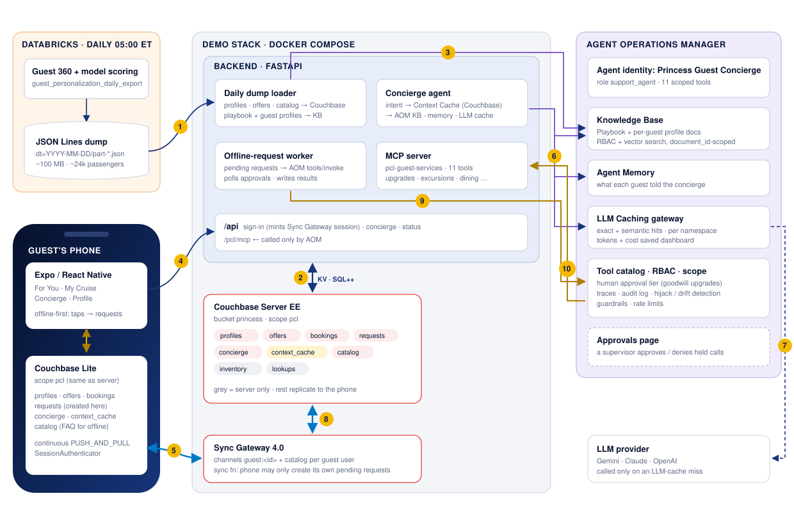
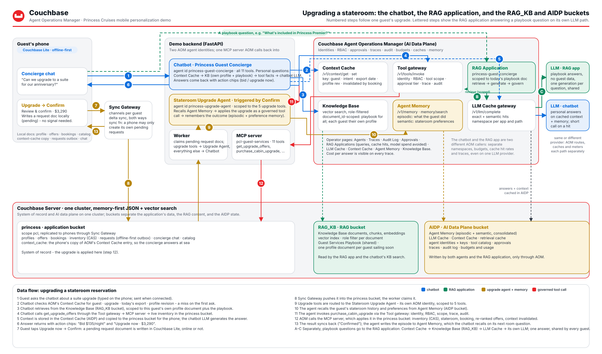
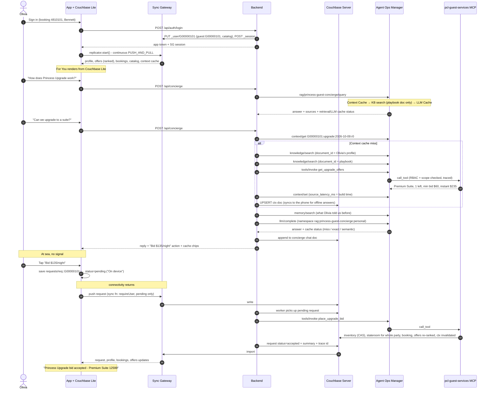
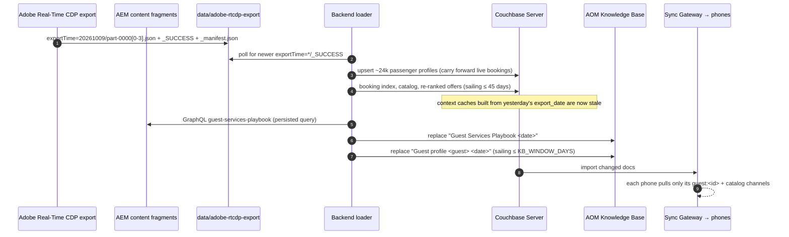
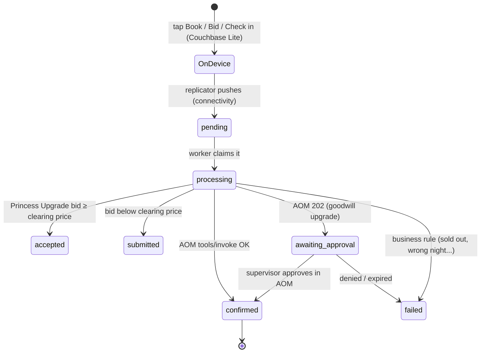

# Princess Cruises · Mobile RAG Personalization Demo

A guest-facing cruise app that personalizes itself from the guest context Princess keeps in **Adobe Experience Platform**: a **daily Adobe Real-Time CDP profile export** (unified guest profile, audiences, Customer AI scores) for the data on the phone, the **Real-Time CDP Profile Access API** for the guest's current audiences when the concierge builds context, and **AEM content fragments** for the Guest Services Playbook. It keeps working **at sea with no signal** because the data lives on the phone in **Couchbase Lite**. Its concierge agent is **registered with, and governed by, the Couchbase Agent Operations Manager (AOM)**:

* answers are grounded in AOM's **Knowledge Base**
* it is registered as an AOM **RAG Application** (`princess-guest-concierge`), so its queries, cache hits and cost savings show on AOM's *RAG Applications* page
* the context it builds for each answer is cached in AOM's **Context Cache** and in Couchbase, which syncs it to the phone
* LLM calls go through AOM's **LLM Caching** gateway
* every booking (room upgrades, shore excursions, dining, packages, spa, check-in) runs as an RBAC-checked, traced and audited AOM tool call, with human approval for complimentary upgrades

The app's structure is based on [Fujio-Turner/mobile_field_service](https://github.com/Fujio-Turner/mobile_field_service): Expo / React Native, Couchbase Lite via `cbl-reactnative`, Sync Gateway session auth, and offline-first writes that sync when the radio comes back.

*Screenshots: run the stack and open `http://localhost:8081` - the Royal Caribbean sibling repo has the same screens in `docs/images/` for reference.*

---

## How the demo opens

`http://<host>:8081/story` is **Personalization That Sails**, an eight-chapter story for the room before the live app, about cutting the LLM cost of an AI concierge with the Agent Operations Manager. Use ←/→ to move between chapters, **N** for talking points and ☾ for dark mode:

1. **The question costs money.** Live chat has hours and a queue; a naive LLM chatbot pays the model for every question; at sea nothing answers at all. It closes with Olivia's two questions from a catamaran off St. Maarten, both answered from her phone.
2. **Where the LLM bill comes from.** Four cost drivers (repeat questions, context rebuilt every turn, unscoped retrieval, no answer offline) and the fix for each: AOM's LLM Cache, Context Cache, scoped RAG application, and cached context synced to Couchbase Lite.
3. **How it usually gets built.** Every box between the question and the answer is a bill. Press **Transform the stack**, or **T**.
4. **The same questions, two bills.** Five questions walked through an AOM-governed concierge and a plain chatbot, with a running LLM spend on each phone. Press **Next step**, or Space.
5. **One data plane for the AI.** Adobe Real-Time CDP and AEM to Couchbase to the AOM Knowledge Base, RAG app and caches, and on to the phone, with live cache hit rates and model calls avoided from the running backend.
6. **Where the savings come from.** Question by question, with and without AOM.
7. **See it run.** Links to the app and the AOM dashboard, plus a five-minute script that ends with Confirm triggering the Stateroom Upgrade Agent and Agent Memory.

The phone frame's side panel links back to the story. The page is served by the `web` container (`web/story.html`). Its live numbers come from `/api/status`, which now includes `metrics`: concierge turns, context-cache and LLM-cache hit rates, and requests that were queued offline and synced later. The AOM link uses `AOM_DASHBOARD_URL`.

## What the demo shows

| Concept | Where you see it |
|---|---|
| **Personalization from Adobe Real-Time CDP** | *For You* ranks upgrades, packages, excursions, dining and spa offers per guest. The ranking uses the Customer AI scores, audiences and preferences from that morning's Real-Time CDP export, plus live inventory. The feed re-ranks after every booking. |
| **Couchbase Lite: offline and online** | Every screen renders from the on-device database. Turning on *Profile → At sea - no signal* pauses replication. You can still browse, place a Princess Upgrade bid or book an excursion: it's saved as a `requests` document marked **On device**, and when you turn the switch off it syncs and is confirmed. |
| **Registered with AOM** | `scripts/register_with_aom.py` sets up four things in AOM: the **Princess Guest Concierge** agent identity (role `support_agent`, scoped to 11 tools), the **`pcl-guest-services`** MCP server, the approval tier for goodwill upgrades, and the **`princess-guest-concierge` RAG Application**. |
| **AOM RAG Application** | Playbook questions ("How does Princess Upgrade work?") go to `POST /v1/agent/rag/princess-guest-concierge/query`. AOM retrieves behind its Context Cache, generates behind its LLM Cache, and counts the query on the *RAG Applications* page. The app is scoped to the one *Guest Services Playbook* document, so a generic question can never retrieve another guest's profile. The loader re-scopes it to each day's new playbook. |
| **Knowledge Base fed by Adobe** | The loader publishes the *Guest Services Playbook*, rendered from the AEM `guest-services-playbook-entry` content fragments (`adobe/aem/`), plus one *Guest profile* document from the Real-Time CDP export for each passenger sailing soon. The concierge always searches with a `document_id` filter, so a guest's answer can only be grounded in **their own** profile. |
| **Context Caching** | For personal questions the concierge assembles context - the guest's **current Adobe Real-Time CDP profile view** (Profile Access API: audience memberships and Customer AI scores, a 120-350 ms round trip shown as an `Adobe Real-Time CDP · …ms` chip), their own KB profile chunks, playbook chunks and live tool facts - and caches it in **AOM's Context Cache** (`/v1/context/set`, namespace `rag:princess-guest-concierge:guest-context`, key `<guest>:<intent>:<export_date>:r<profile rev>`, with the real build time as `source_latency_ms`). The next question is a `/v1/context/get` hit, shown as a `Context cache · hit` chip and as latency avoided on AOM's *Context Cache* page. The next export or any booking by that guest changes the key, so the entry is never served stale. The same context is written to Couchbase as `ctx::<guest>::<intent>`, which syncs to the phone; that copy is what the offline concierge answers from. |
| **LLM Caching** | Every completion goes through AOM's LLM cache. Playbook questions contain no personal data, so the second guest to ask the same question gets `LLM cache · exact hit` from the RAG application. Personal questions go through `/v1/llm/complete` in the `rag:princess-guest-concierge:personal` namespace, which AOM also attributes to the RAG application. |
| **Governed actions** | Upgrades (Princess Upgrade bid, instant, goodwill), excursions, specialty dining, packages, spa and online check-in all run as `POST /v1/tools/invoke`. AOM re-checks RBAC and the agent's tool scope, traces and audits the call, scans the response, and holds goodwill upgrades for a person to approve. |
| **Stateroom Upgrade Agent + Agent Memory** | **Confirm** on the upgrade screen creates a `purchase_cabin_upgrade`, `place_upgrade_bid` or `apply_goodwill_upgrade` request. The worker hands those to a second AOM identity, the **Princess Stateroom Upgrade Agent** (`backend/app/upgrade_agent.py`, scoped to the 5 upgrade tools). It first recalls the guest's stateroom history and preferences from **AOM Agent Memory** (`POST /v1/memory/search`), applies the upgrade as a governed tool call attributed to itself, then writes what happened back to memory (`POST /v1/memory`: from/to category and stateroom, sailing, what was paid or bid, the occasion). The request card shows *Run by the Stateroom Upgrade agent · Remembered in AOM Agent Memory*, and the concierge recalls the same memory on its next answer about rooms. |

---

## Architecture



| # | Flow |
|---|---|
| **1** | Every morning the Real-Time CDP dataset export lands an `exportTime=YYYYMMDD` JSON Lines partition, and the loader picks up the newest one with a `_SUCCESS` marker. |
| **2** | The loader upserts every passenger profile, re-ranks offers and publishes the catalog in Couchbase Server. The concierge reads and writes its **context cache** there, the worker reads pending requests, and the MCP tools apply bookings. |
| **3** | The loader replaces the AOM **Knowledge Base** documents (the Guest Services Playbook and one profile per passenger sailing soon), then re-scopes the **RAG Application** to the new playbook. |
| **4** | Sign-in: the backend creates the guest's Sync Gateway user (channels `guest:<id>`, `catalog`) and mints a session. The concierge is called over `/api`. |
| **5** | **Couchbase Lite** replicates continuously with Sync Gateway. Every screen renders from the phone, and taps become `requests` documents saved locally, even offline. |
| **6** | Playbook questions go to the concierge's **RAG Application** in one call. Personal questions check AOM's **Context Cache**; on a miss the concierge does document-scoped **KB retrieval**, stores the context in AOM and Couchbase, recalls **memory**, then calls the **LLM Caching** gateway. |
| **7** | AOM calls the LLM provider only on a cache miss. |
| **8** | Sync Gateway carries requests up and results back down: the phone pushes its pending request, and the confirmed stateroom, booking and re-ranked offers come back. |
| **9** | The worker runs each request as the **Princess Guest Concierge** agent through `POST /v1/tools/invoke`, so RBAC, tool scope, the approval tier, a trace and an audit entry are applied. |
| **10** | AOM calls the `pcl-guest-services` MCP server, which applies the upgrade or booking in Couchbase, and that syncs back to the phone (2 → 8 → 5). |

### Upgrading a stateroom: the chatbot, the RAG application and the two AI buckets



The chatbot (Princess Guest Concierge) and the RAG application are two different AOM callers with separate namespaces, budgets and cache hit rates. The `RAG_KB` bucket holds the Knowledge Base; the `AIDP` bucket holds AOM's Agent Memory, LLM and Context Caches, identities, traces and audit; the `princess` bucket is the system of record the upgrade is applied in. Steps 1-13 follow one guest from "Can we upgrade?" through **Confirm**, the Stateroom Upgrade Agent and Agent Memory; A-C show a playbook question answered once by the RAG application for every guest.

### A guest's workflow, end to end

Olivia (Captain's Circle Elite, anniversary, Balcony on *Sun Princess* in 9 days) signs in, asks the concierge about a suite, bids with Princess Upgrade while she's offline, and the result syncs back when she reconnects:



A goodwill upgrade follows the same path. The difference is that AOM answers `202 pending_approval`: the request shows **Awaiting supervisor** on the phone until someone approves it on AOM's Approvals page. The worker then re-invokes with the `approval_id`.

### The daily data flow



### Offline-first request lifecycle



---

## Quick start

### 1. Browser preview in about 2 minutes (no Docker, no AOM)

The backend can run on an in-memory store, and the app has a browser preview engine that syncs the same documents over REST. Use this to look at the UX. Couchbase Lite needs a device build (step 3).

```bash
python3 adobe/generate_mock_export.py               # ~100 MB export → data/adobe-rtcdp-export/exportTime=<today>/
cd backend && python3 -m venv .venv && . .venv/bin/activate && pip install -r requirements.txt
uvicorn app.main:app --port 8200                    # STORE_DRIVER=memory by default
# new terminal
cd mobile && npm install && npx expo start --web    # sign in with a demo guest
```

### 2. Full stack: Couchbase, Sync Gateway and AOM

You need Docker Desktop, and the [Couchbase Agent Operations Manager](https://github.com/erikhinderer/couchbase-agent-operations-manager) running on the same machine at `https://localhost:8090`, with its admin password set.

```bash
cp .env.example .env
./scripts/setup-corporate-ca.sh            # only behind a TLS-inspecting proxy (Zscaler etc.)
docker compose up -d --build               # couchbase, init, sync-gateway, sg-init, backend, web
docker compose logs -f backend             # wait for "Loaded Real-Time CDP export 2026-10-09: … rows"

python3 scripts/register_with_aom.py --admin-password '<AOM admin password>'
docker compose up -d --build backend       # picks up AOM_* from .env, publishes the KB, scopes the RAG app
```

`register_with_aom.py` is idempotent. Run it again with `--rotate` to issue a new agent key. After it runs, AOM shows:

* **Agents**: *Princess Guest Concierge*, role `support_agent`, scoped to the 11 `pcl-guest-services::*` tools, and *Princess Stateroom Upgrade Agent*, scoped to the 5 upgrade tools (key written to `.env` as `AOM_UPGRADE_AGENT_API_KEY`)
* **Servers / Catalog**: `pcl-guest-services` (trusted) and its tools
* **Knowledge**: *Guest Services Playbook <date>* and *Guest profile G… <date>* documents
* **Approvals config**: `pcl-guest-services::apply_goodwill_upgrade` requires a human
* **RAG Applications**: *Princess Guest Concierge (mobile)* (`princess-guest-concierge`), roles `support_agent` and `admin`, scoped to today's playbook document. Its activity counts playbook queries plus the concierge's personal LLM calls and context-cache lookups, all in `rag:princess-guest-concierge:*` namespaces
* **Context Cache**: entries in `rag:princess-guest-concierge:guest-context` (one per guest and intent) and `rag:princess-guest-concierge` (the RAG app's retrievals)

If the RAG application is created before the backend has published a playbook, it is registered **disabled**. The backend enables it and sets its document scope on its next load. `GET http://localhost:8200/api/status` shows its state under `aom.rag_app`.

Configure an LLM provider key in AOM to get generated answers. Without one, AOM returns a labelled stub: the backend then writes the answer itself from the same retrieved context, and AOM still reports the LLM-cache status (hit or miss).

Then open **http://localhost:8081/story** for the story that opens the demo, **http://localhost:8081** for the app in a browser, or **http://localhost:8200** for a page linking every service.

| Port | Service |
|---|---|
| `8081` | **The app in a browser** (`web` service), shown inside a phone frame (add `?frame=0` for full width): same screens and documents, synced over REST instead of Couchbase Lite |
| `8200` | Backend API + MCP server (`/pcl/mcp`); `/` lists every link |
| `4984` | Sync Gateway public, which is what phones replicate with: `ws://<host>:4984/princess` |
| `127.0.0.1:4985` | Sync Gateway admin |
| `127.0.0.1:18091` | Couchbase Web Console (Administrator / password123) |

Ports are chosen so this stack runs alongside AOM (8090, 8091-8096) and the NOV demo.

### 3. The app on a device with Couchbase Lite

Couchbase Lite is a native module, so it needs a **development build**; Expo Go can't load it, the same as mobile_field_service. `npm install` runs `scripts/fetch-cbl-native.sh`, which fetches the `cbl-reactnative` native submodules that npm skips.

```bash
cd mobile
cp .env.example .env                       # API + Sync Gateway URLs (LAN IP for a physical phone)
npm install
npx expo run:ios -d "iPhone 16 Pro"        # or: npx expo run:android
npm run start:ios                          # later runs: Metro on localhost
```

The `web` service serves a prebuilt browser bundle (`web/dist.tgz`). After changing the app, rebuild it with `cd mobile && npm run export:web:docker`, then `docker compose up -d --build web`.

With `EXPO_PUBLIC_DB_ENGINE=auto`, the app uses Couchbase Lite whenever the native module is linked. *Profile → Offline & sync* shows the database path, the Sync Gateway endpoint, the replicator status and how many documents are waiting to send. The same notes as mobile_field_service apply: Xcode 26.4+ needs `plugin.fmt.js` (included), and there is a simulator keyboard toggle (⌘K).

### 4. Kubernetes with Helm (K3s / Rancher)

`deploy/k8s/deploy.sh` deploys AOM (**agent-ops**) and this demo (**princess-app**) onto a single-node K3s cluster, such as one managed by Rancher, without a container registry. Run it from your Mac, in this repository:

```bash
AOM_ADMIN_PASSWORD='<12+ characters>' ./deploy/k8s/deploy.sh      # MOTHER=ehind@192.168.111.4 by default
# mother already runs AOM and the Royal Caribbean demo (royal-app): add this one next to them
AOM_ADMIN_PASSWORD='<current AOM password>' ONLY=princess ./deploy/k8s/deploy.sh
```

`deploy/k8s/values-mother.yaml` publishes this demo on **8082 / 8201 / 4986** so it can run alongside `royal-app` on 8081 / 8200 / 4984. Both demos register with the same AOM under different ids (`pcl-guest-services`, *Princess Guest Concierge*, `princess-guest-concierge`), so they show up side by side on AOM's Agents, Servers and RAG Applications pages.

It runs four steps:

1. **Build.** It builds the three AOM images from `AOM_DIR` (default `~/github-couchbaselabs/couchbase-agent-operations-manager`) and this demo's `pcl-backend` and `pcl-web` images, for the node's CPU architecture.
2. **Import.** It copies the images over SSH and imports them into K3s's containerd. This asks for your sudo password on the node once.
3. **Install.** It runs `helm upgrade --install` on the node for both charts, and installs helm into `~/.local/bin` there if it's missing:
   * `aom` in namespace `agent-ops`, from AOM's own chart with `values-k3s.yaml`
   * `princess-app` in namespace `princess-app`, from [`helm/princess-app`](helm/princess-app) with [`deploy/k8s/values-mother.yaml`](deploy/k8s/values-mother.yaml)
4. **Secrets.** The AOM admin password and any `ANTHROPIC_API_KEY` / `OPENAI_API_KEY` / `GEMINI_API_KEY` go into mode-600 values files on the node, never onto a command line.

| Resource in `princess-app` | What it does |
|---|---|
| `couchbase` StatefulSet + `couchbase-init` hook Job | Couchbase Server EE 8.0.2. The Job runs the same `init.sh` as Compose |
| `sync-gateway` + `sg-init` hook Job | Sync Gateway 4.0.4. `sync-gateway-public` exposes 4984 for Couchbase Lite |
| `backend` | Loads the Real-Time CDP export into Couchbase and serves the MCP server. Self-registers with AOM (`AOM_AUTO_REGISTER`, see below) |
| `rtcdp-export` PVC | Holds the export. The backend's init container writes today's 100 MiB mock partition on first start |
| `rtcdp-daily-export` CronJob | 05:00 America/New_York: writes a new partition (as the Real-Time CDP destination would) and keeps the newest 2. The backend picks it up within 5 minutes |
| `web` | The phone-framed app on 8082 (8081 in Compose). nginx proxies `/api` to the backend, so the browser needs only one URL |

**Self-registration.** No register script is needed in the cluster. With `AOM_AUTO_REGISTER=true`, the backend does the following on startup and retries until AOM is up:

* signs in to AOM. On a fresh AOM, it sets `AOM_ADMIN_PASSWORD` as the admin's first-login password
* registers `pcl-guest-services` at `http://backend.princess-app.svc.cluster.local:8200/pcl/mcp` (the in-cluster port; the published port is 8201)
* issues the *Princess Guest Concierge* and *Princess Stateroom Upgrade Agent* identities and keeps their keys in Couchbase
* turns on the approval tier
* publishes the Knowledge Base and the RAG application

Progress is in `/api/status` under `aom.registration`.

| URL on the node (192.168.111.4) | |
|---|---|
| `https://…:3111` | AOM dashboard (`admin` / `AOM_ADMIN_PASSWORD`) |
| `http://…:8082/story` | The story: start here |
| `http://…:8082` | The app |
| `http://…:8201/api/status` | Backend status |
| `ws://…:4986/princess` | Sync Gateway for Couchbase Lite (point a device build's `EXPO_PUBLIC_SG_URL` here, and `EXPO_PUBLIC_API_URL` at `:8201`) |

Ports are published by K3s's built-in ServiceLB. If a Service stays `<pending>`, either ServiceLB is disabled or the port is already taken on the node. In that case, set that Service's `type: NodePort` in `values-mother.yaml`. Redeploy just one side with `ONLY=aom` or `ONLY=princess`.

---

**Deploying on the node itself from GitHub.** The repository is public, so a node that can reach GitHub can deploy without a workstation: `deploy/k8s/deploy-on-mother.sh` clones or fast-forwards the repo into `~/pcl-deploy/src` (and, with `ONLY=aom`, the AOM repo into `~/pcl-deploy/aom-src`), builds the images there with Docker, imports them into K3s and runs the Helm install - `deploy.sh` with `MOTHER=local`.

```bash
# first time, on mother
curl -fsSL https://raw.githubusercontent.com/Couchbase-Field-Engineering/princess-mobile-rag-personalization-demo/main/deploy/k8s/deploy-on-mother.sh \
  | AOM_ADMIN_PASSWORD='<AOM admin password>' bash
# afterwards
AOM_ADMIN_PASSWORD='<AOM admin password>' ~/pcl-deploy/src/deploy/k8s/deploy-on-mother.sh
```

`BRANCH`, `FORCE_DUMP=true`, `SKIP_BUILD=1 TAG=<tag>` and `ONLY` work as for `deploy.sh`. The node needs git, Docker with buildx, and sudo for `k3s ctr images import`.

## Demo script (about 10 minutes)

1. **Olivia Bennett** (Captain's Circle Elite, anniversary, *Sun Princess*, Balcony, 9 days out)
   * *For You*: check-in first, then **Upgrade to a Premium Suite** ("Only 1 left · Perfect for your anniversary"), then Love by Britto and a Couples Massage at the Lotus Spa. Point out the footnote: the scores come from Adobe Customer AI via Real-Time CDP and the data lives in Couchbase Lite.
   * *Concierge*: "Can we upgrade to a suite?" shows `Context cache · built` and `LLM cache · miss`. Ask it again: `Context cache · hit` and `LLM cache · exact hit`. Open **sources**: Olivia's KB profile and the playbook.
   * *Profile → At sea - no signal* **on**. Place a Princess Upgrade bid (**On device**), then ask "What's included in Princess Premier?" (**Answered on device · Couchbase Lite**). Switch it **off**: the bid syncs and comes back **Accepted - Premium Suite**. In AOM, show the trace and audit entry for `pcl-guest-services::place_upgrade_bid`.
   * "Our room is noisy and the AC is broken" offers **Request complimentary upgrade**, which shows **Awaiting supervisor**. Approve it in AOM → *Approvals*, and the phone flips to **Confirmed**.
2. **Priya Natarajan** (Platinum, solo wellness, *Star Princess*, Mini-Suite, sails in 2 days): asks "How does Princess Upgrade work?" and gets an **LLM cache exact hit** from Olivia's earlier question, because the playbook namespace is shared and has no personal data. Her feed leads with the spa and Chef's Table.
3. **Carlos Rivera** (Gold, family of four, *Caribbean Princess* 3-night Princess Cays getaway, Interior): the feed leads with family excursions and Princess Premier. Booking the Princess Cays aqua park is priced for 4, and the Love by Britto is correctly refused because it isn't on Caribbean Princess.

## Fleet chatbot workload: LLM Caching and Context Caching under load

Three personas show *how* the caches work; the fleet workload shows what they do to a real queue. `POST /api/demo/workload` (the **Run fleet workload** button on the story page, or the script below) plays guests from all 17 Princess ships against the concierge, through the same path the phone uses: AOM RAG Application for playbook questions, AOM Context Cache + Knowledge Base + governed MCP tools for personal ones, AOM Agent Memory for what guests say about themselves, and `/v1/llm/complete` in the `rag:princess-guest-concierge:*` namespaces. Nothing is simulated on the AOM side - the point is to fill AOM's **LLM Cache**, **Context Cache**, **RAG Applications** and **Traces** pages with production-shaped traffic.

```bash
# against the deployment on mother (backend :8201, AOM dashboard https://192.168.111.4:3111)
python scripts/run_chatbot_workload.py
# bigger, faster, or a few ships
python scripts/run_chatbot_workload.py --guests-per-ship 6 --turns 8 --concurrency 8 --ships SUN,STR,ENC
python scripts/run_chatbot_workload.py --plan      # who asks what, without running
python scripts/run_chatbot_workload.py --stop
```

What a passenger asks (`backend/app/workload.py`, `USE_CASES`): check-in, arrival time, documents, the Medallion, luggage and parking; upgrades and suite perks; shore excursions, Princess Cays, cancellations; dining, dietary needs, dress code, celebrations; Princess Plus / Premier, drinks, Wi-Fi, OceanNow; spa, fitness; itinerary and port times; kids, gratuities, smoking, laundry, casino, currency, medical, accessibility, Captain's Circle; and a noisy cabin (service recovery, behind the approval tier). The traffic is shaped the way a support queue is:

* **Playbook questions** are drawn Zipf-style, so a few dominate. Most guests use the canonical wording (**exact hits** after the first guest pays for the answer), `--paraphrase-ratio` of them reword it (**semantic hits**), the long tail misses.
* **Personal questions** build a per-guest, per-intent context once (`Context cache: built`); the follow-up in the same intent reuses it (**hit**); `--repeat-ratio` of guests ask the same thing again (**exact LLM hit**, same prompt).
* **Statements** ("we're vegetarian") go to Agent Memory and are recalled on that guest's later turns.

The run reports per ship, per use case and per cache outcome (`GET /api/demo/workload`), and the story page shows it live. Guests are picked from the loaded export among those sailing within `--window-days` (default 45), lead guests first, so every ship in the catalog gets passengers.

## Reset the demo

`POST /api/demo/reset` (the **Reset demo** button on the story page, or `python scripts/reset_demo.py`) puts the demo back to the state of today's export. For the three personas plus every guest who changed something since the load (or `--guests G00000201`): their `requests`, chat and cached context are deleted, their profile is reloaded from the export partition (stateroom, check-in, purchases, `rev` 0), the sold staterooms of their sailing are released, their offers re-ranked, and they are dropped from `live_guests`. Sync Gateway replicates the deletes and the fresh profile to the phone. In AOM, their Agent Memory entries are deleted and the concierge's cache namespaces (`rag:princess-guest-concierge*`, including the RAG application's own) are purged, so the next demo starts with a visible `miss` again; traces, audit log and approvals history are left alone. `--keep-aom-memory` / `--keep-aom-caches` / `--keep-counters` narrow it.

---

## The Adobe Real-Time CDP export

`adobe/generate_mock_export.py` writes the layout the Real-Time CDP dataset-export destination delivers (`adobe/rtcdp/dataset-export-destination.json`): JSON Lines part files under `exportTime=YYYYMMDD/`, `_SUCCESS`, and a `_manifest.json` with the dataset, sandbox and schema ids.

```bash
python3 adobe/generate_mock_export.py --export-date 2026-10-09 --target-mb 100 --parts 4
```

* **About 22,000 guest profiles** (about 7,600 bookings) over the 17-ship fleet (Caribbean, Mexican Riviera, Panama Canal, Australia, Japan and Southeast Asia home ports) and 150 days of sailings, 100 MiB, deterministic for a given `--seed` on a given Python version. Each part is about 25 MB, under GitHub's 50 MB warning.
* One line is **one guest on one upcoming reservation**: the stitched `identity` (ECID, CRM id, guest id namespace), Captain's Circle tier and points, the reservation (ship, itinerary with port days, stateroom, party, check-in status), preferences, up to 12 past sailings, onboard spend mix, what's already purchased for this sailing, the **`audiences`** the profile qualifies for (Upgrade propensity - high, Celebrating on board, Wellness escapers, Families with children, ...) and **`ml_scores`** from Customer AI (`customer-ai-propensity-v2`).
* `ml_scores` holds the propensities (upgrade, beverage, dining, excursion, spa, internet, Princess Premier), price sensitivity, segment, next best action, recommended upgrade category and suggested Princess Upgrade bid.
* Three hand-built **demo personas**, with sailings relative to the export date, are always the first rows.
* `adobe/rtcdp/README.md` describes the two production integrations: the scheduled dataset export (batch, 05:00 America/New_York) and the Profile Access API the concierge calls for the current profile when it builds context. `adobe/aem/` holds the playbook's content-fragment model and persisted GraphQL query.

The loader only needs a folder with a newer `exportTime=*/_SUCCESS` to appear: point the destination's cloud storage (or a sync of it) at the backend container's `/data/adobe-rtcdp-export`.

## Data model

Bucket `princess`, scope `pcl`. Sync Gateway replicates the first seven collections to Couchbase Lite (same scope and collection names on the phone). A guest's SG user only gets the `guest:<id>` and `catalog` channels.

| Collection | Document | Written by | Notes |
|---|---|---|---|
| `profiles` | `profile::<guest>` | loader, actions | The Real-Time CDP profile row (+ `identity`, `audiences`) + `rev` (bumped on every booking) |
| `offers` | `offers::<guest>` | personalization | Ranked *For You*, including upgrade options for offline use |
| `bookings` | `bookings::<guest>` | actions | Confirmed items shown day by day |
| `requests` | `req::<guest>::<uuid>` | **the phone** (create), worker (status) | Offline-first queue. The sync function allows `requireUser(guest_id)`, `status: pending` and creation only |
| `concierge` | `chat::<guest>` | concierge | History + answers reusable offline |
| `context_cache` | `ctx::<guest>::<intent>` | concierge | Phone copy of the **Context Cache** entry also held in AOM: KB chunks + tool facts, `export_date`, `profile_rev`, TTL 6h |
| `catalog` | `catalog::v1` | loader | Ships, ports, excursions, dining, packages, spa, FAQ |
| `inventory` | `inv::<sailing>` | actions | Unsold staterooms per category (CAS updates). Server only |
| `lookups` | `booking::…`, `kbdoc::…`, `load_state` | loader | Login index, KB document ids, load status. Server only |

The tools on the `pcl-guest-services` MCP server are `get_guest_context`, `get_upgrade_offers`, `place_upgrade_bid`, `purchase_cabin_upgrade`, `apply_goodwill_upgrade` (approval required), `search_shore_excursions`, `book_shore_excursion`, `reserve_specialty_dining`, `purchase_package`, `book_spa_treatment` and `complete_online_checkin`.

---

## Configuration

Backend variables go in `.env` (see `.env.example`); `docker-compose.yml` sets the infrastructure ones.

| Variable | Default | |
|---|---|---|
| `STORE_DRIVER` | `memory` (compose: `couchbase`) | `memory` keeps guests sailing within `MEMORY_WINDOW_DAYS` |
| `AOM_URL`, `AOM_AGENT_API_KEY` | — | Concierge agent identity, written by `register_with_aom.py` |
| `AOM_UPGRADE_AGENT_API_KEY` | — | Stateroom Upgrade Agent identity, written by `register_with_aom.py`; blank = upgrades run as the concierge |
| `AOM_ADMIN_USERNAME`, `AOM_ADMIN_PASSWORD` | — | Used only to publish KB documents |
| `AOM_LLM_PROVIDER`, `AOM_LLM_MODEL` | AOM default | Pin the model completions use |
| `KB_WINDOW_DAYS`, `KB_PROFILE_LIMIT` | `10`, `150` | Which passengers get a KB profile each day |
| `CONTEXT_CACHE_TTL_SECONDS` | `21600` | Upper bound; the export date and profile rev invalidate it sooner |
| `RAG_APP_ID` | `princess-guest-concierge` | AOM RAG Application id; `RAG_APP_ENABLED=false` skips it |
| `LLM_NAMESPACE_PERSONAL` / `_PLAYBOOK` | `rag:princess-guest-concierge:personal` / `:playbook` | Keep the `rag:<app_id>:` prefix so AOM attributes the activity to the app |
| `CONTEXT_NAMESPACE` | `rag:princess-guest-concierge:guest-context` | AOM Context Cache namespace for personal context |
| `DEMO_TODAY` | export's `export_date` | Keeps "9 days to sail" stable whenever you demo |
| `RTCDP_EXPORT_DIR`, `RTCDP_POLL_SECONDS` | `data/adobe-rtcdp-export`, `600` | Where the Real-Time CDP export lands and how often to look |
| `ADOBE_IMS_CLIENT_ID` / `_SECRET` / `ADOBE_IMS_ORG_ID`, `ADOBE_SANDBOX` | — | Real-Time CDP Profile Access API (blank = mock mode from the exported profile, `ADOBE_MOCK_LATENCY_MS=120,350`) |
| `AEM_GRAPHQL_ENDPOINT`, `AEM_TOKEN` | — | AEM publish host for the playbook content fragments (blank = bundled fragments) |
| `SG_PUBLIC_URL` | — | Replication URL handed to phones |

App variables (`mobile/.env`): `EXPO_PUBLIC_API_URL`, `EXPO_PUBLIC_SG_URL`, `EXPO_PUBLIC_DB_ENGINE` (`auto` · `cbl` · `preview`).

---

## Tests

```bash
cd backend && pytest -q          # 23 tests
cd mobile && npm run typecheck
```

`test_demo_flows.py` covers personalization, the context cache (hit, then invalidation after a booking), the offline request flow, business-rule failures, and push authorization. `test_aom_integration.py` runs the backend against `tests/fake_aom.py`, which has the same routes and shapes as AOM. It checks KB publishing, document-scoped retrieval, RAG application registration and its playbook-only scope, personal context cached through AOM's Context Cache, the LLM cache shared across guests for playbook questions but not personal ones, tool calls over real MCP, and the approval tier, and runs the fleet workload through it (exact hits across guests, context hits on follow-ups). `test_workload.py` checks the workload's fleet coverage, plan and report in memory mode; `test_reset.py` checks the demo reset restores a persona after an upgrade. `test_aom_bootstrap.py` starts the backend with `AOM_AUTO_REGISTER` against a *fresh* fake AOM and checks that it registers itself end to end.

---

## Repository layout

```
backend/            FastAPI API, MCP server, loader, worker, concierge (Python)
  app/catalog.py        fleet, staterooms, excursions, dining, packages (shared with the generator)
  app/personalization.py  For You ranking
  app/actions.py        upgrade / booking business logic behind every tool
  app/concierge.py      intent → AOM RAG app (playbook) | AOM Context Cache → KB + memory + LLM cache (personal) → actions
  app/workload.py       fleet chatbot workload: every ship's guests × passenger use cases → the concierge → AOM caches
  app/demo_reset.py     back to today's export: guest docs, profile, inventory, offers; AOM memories and cache namespaces
  app/rag_app.py        the concierge's AOM RAG Application definition, re-scoped daily
  app/loader.py         daily Real-Time CDP export → Couchbase + AOM Knowledge Base
  app/adobe.py          Adobe clients: Real-Time CDP Profile Access (context) and AEM GraphQL (playbook), mock or live
  app/worker.py         offline-first requests → AOM tools/invoke (upgrades → the upgrade agent)
  app/upgrade_agent.py  Stateroom Upgrade Agent: Agent Memory recall → governed upgrade → remember the outcome
  app/aom_bootstrap.py  self-registration with AOM (Kubernetes)
mobile/             Expo app (Couchbase Lite engine + browser preview engine)
adobe/              mock Real-Time CDP export generator; rtcdp/ destination + Profile API notes; aem/ playbook content-fragment model + query
couchbase-init/     bucket / scope / collections / indexes
sync-gateway/       bootstrap + database config with per-collection sync functions
scripts/            register_with_aom.py, run_chatbot_workload.py, reset_demo.py, setup-corporate-ca.sh
web/                nginx image serving the browser build of the app on :8081 (proxies /api to the backend)
helm/princess-app/     Helm chart for the demo (Couchbase, Sync Gateway, backend, daily export CronJob, web)
deploy/k8s/         deploy.sh + values for the K3s node "mother" (AOM and the demo)
data/               the Real-Time CDP export landing folder
```

## Notes

* **Brand.** The palette is Princess Cruises-inspired (deep navy, Princess blue, champagne gold, sea blue), with a plain text wordmark and a generic icon. Ship, port, restaurant, package and loyalty names are Princess Cruises' public product names used to set the scene; this is not an official Princess Cruises or MedallionClass application. No logos or licensed assets are included; use official brand assets under the appropriate agreement for any customer-facing build. Prices, inventory and policies are illustrative demo data.
* **Couchbase licensing.** Couchbase Server EE and Sync Gateway EE images run under the free developer license for dev and test. Shipping Couchbase Lite with encryption requires an Enterprise license, the same as mobile_field_service.
* **Credits.** `plugin.config.js`, `plugin.fmt.js`, `metro.config.js` and the two `mobile/scripts` come from [mobile_field_service](https://github.com/Fujio-Turner/mobile_field_service) (Apache-2.0).
